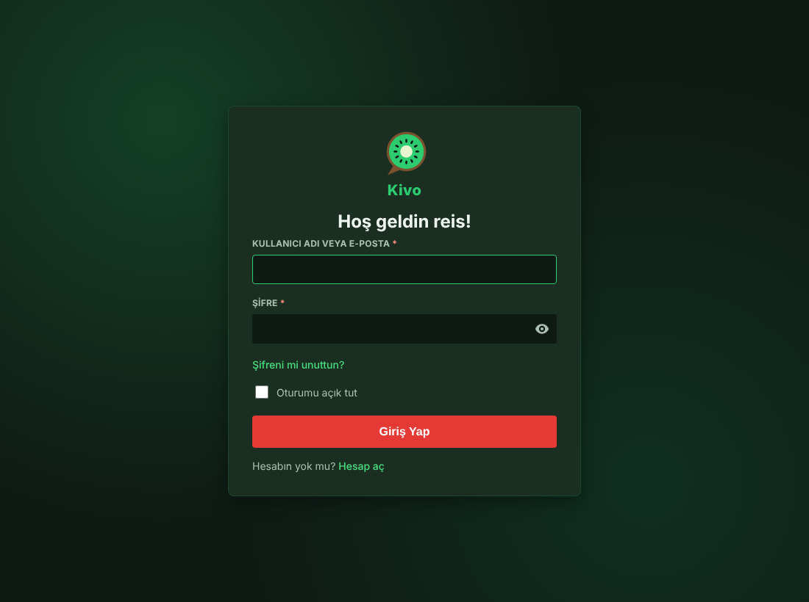

# Kivo: Discord'dan ilham alan gerçek zamanlı sohbet platformu

> 🚧 Geliştirme aşamasında. Şu an: kimlik doğrulama, sunucular, kanallar ve anlık mesajlaşma çalışıyor.



## Teknolojiler
- **Frontend:** React 19, TypeScript, Vite, React Router
- **Backend:** Node.js, Express, Socket.IO (WebSocket), TypeScript, Zod
- **Veritabanı:** Prisma ORM (geliştirmede SQLite, canlıda PostgreSQL)

## Özellikler (şu an)
- Sunucu oluşturma, davet linkiyle katılma, sunucudan ayrılma
- Yazı ve ses kanalları (kanal ekleme sadece kurucuda)
- Sesli sohbet (LiveKit): mikrofon/kulaklık kapatma, konuşan kişi göstergesi, ses kanalında kimlerin olduğunu herkes görür
- WebSocket ile anlık mesajlaşma, "yazıyor…" göstergesi, canlı çevrimiçi/çevrimdışı durumu
- Mesaj geçmişi ve sayfalama ("daha eski mesajları yükle")
- Bağlantı koparsa otomatik yeniden bağlanma ve kaçan mesajları yeniden yükleme
- Kayıt: e-posta, benzersiz kullanıcı adı, görünen ad, şifre + şifre tekrarı
- Kullanıcı adı **veya** e-posta ile giriş
- "Oturumu açık tut" (30 günlük kalıcı oturum ya da tarayıcı oturumu)
- Şifremi unuttum / şifre sıfırlama (tek kullanımlık, 30 dakika geçerli link)
- Şifre göster/gizle, alan bazlı hata mesajları, yüklenme durumu

## Güvenlik
- Şifreler **bcrypt** (12 round) ile hash'lenir, düz metin hiçbir yerde saklanmaz
- JWT, **httpOnly + SameSite** cookie'de tutulur (JavaScript erişemez → XSS ile çalınamaz)
- Girişte **rate limiting** (dakikada 5 deneme)
- Hatalı girişte kullanıcı adının mı şifrenin mi yanlış olduğu söylenmez, kullanıcı yoksa da sahte hash karşılaştırılır (zamanlama saldırısına karşı)
- Şifre sıfırlamada hangi e-postaların kayıtlı olduğu sızdırılmaz; token'ın veritabanında yalnızca SHA-256 hash'i tutulur
- WebSocket bağlantısı da aynı httpOnly cookie ile doğrulanır; sadece sunucu üyeleri o sunucunun mesajlarını görür ve yazabilir
- Mesaj gönderiminde spam koruması (5 saniyede en fazla 8 mesaj)
- Doğrulama hem frontend'de (kullanıcı deneyimi için) hem backend'de (güvenlik için) yapılır

## Kurulum
```bash
# Backend
cd server
npm install
cp .env.example .env        # JWT_SECRET'ı değiştir
npx prisma migrate dev      # veritabanını oluşturur
npm run dev                 # http://localhost:4000

# Frontend (yeni terminal)
cd client
npm install
npm run dev                 # http://localhost:5173
```
Şifre sıfırlama e-postası henüz gerçekten gönderilmiyor; link backend terminaline yazılır.

## API
| Metot | Yol | Açıklama |
|---|---|---|
| POST | `/api/auth/register` | Kayıt |
| POST | `/api/auth/login` | Giriş (`identifier`, `password`, `remember`) |
| POST | `/api/auth/logout` | Çıkış |
| GET | `/api/auth/me` | Oturumdaki kullanıcı |
| POST | `/api/auth/forgot-password` | Sıfırlama linki iste |
| POST | `/api/auth/reset-password` | Yeni şifre belirle |
| GET | `/api/servers` | Üye olduğum sunucular |
| POST | `/api/servers` | Sunucu oluştur |
| GET | `/api/servers/:id` | Sunucu detayı (kanallar + üyeler) |
| POST | `/api/servers/:id/leave` | Sunucudan ayrıl |
| POST | `/api/servers/:id/channels` | Kanal oluştur (kurucu) |
| GET | `/api/invites/:code` | Davet önizlemesi |
| POST | `/api/invites/:code/join` | Davetle katıl |
| GET | `/api/channels/:id/messages?before=` | Mesaj geçmişi (50'şer) |

### WebSocket olayları
| Yön | Olay | Açıklama |
|---|---|---|
| İstemci → Sunucu | `message:send` | Mesaj gönder (onay döner) |
| İstemci → Sunucu | `typing` | "Yazıyor…" bildir |
| Sunucu → İstemci | `message:new`, `typing`, `presence`, `channel:created`, `member:joined`, `member:left` | Canlı güncellemeler |

## Yol haritası
- [x] Kimlik doğrulama
- [x] Sunucular ve davet linkleri
- [x] Metin kanalları + WebSocket ile anlık mesajlaşma
- [x] Çevrimiçi durumu, "yazıyor…" göstergesi
- [ ] Dosya/resim gönderme
- [ ] Roller ve izinler
- [x] Sesli kanal (WebRTC, LiveKit)
